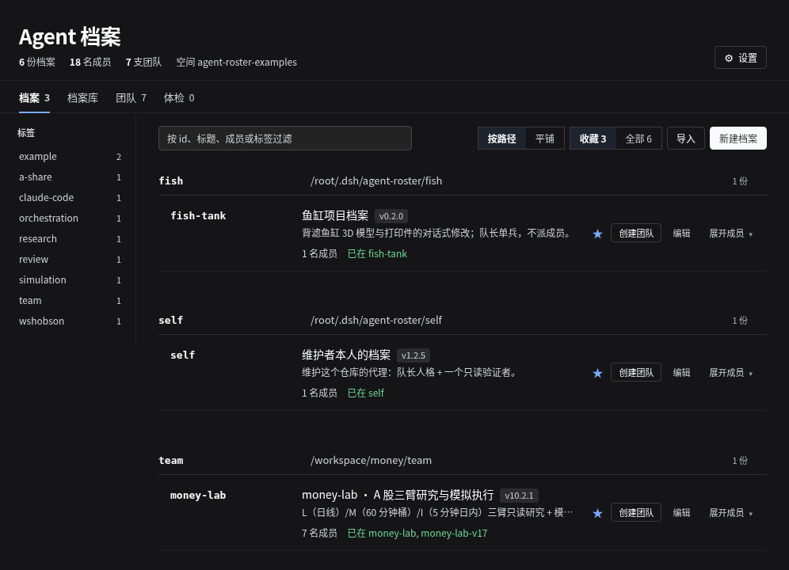
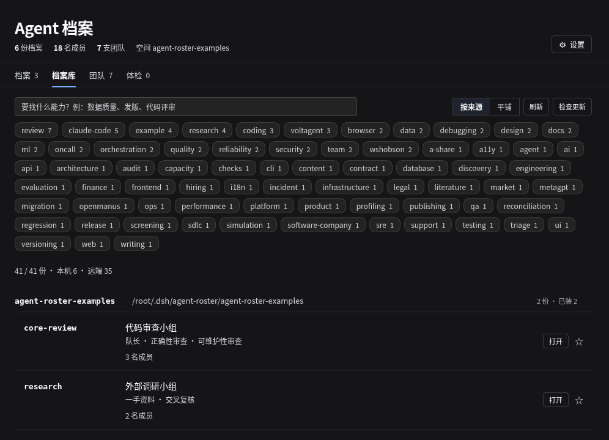

# @stofone/dsh-agent-roster

[**English**](README.en.md) | [简体中文](README.md)

**Write the team down as a file you can review before you build it — then verify what the runtime actually stored after it exists.**

`dsh-agent-roster` is the roster layer for [DeepSeek Harness](https://github.com/deepseek-ai/deepseek-harness) Agent Teams. Personas, model routes and tool boundaries live in YAML/Markdown, compile into one self-contained artifact, and are checked field-by-field against `team.json` once the team is running. It does not run teams and does not replace [`dsh-agent-teams`](https://github.com/NanmiCoder/dsh-agent-teams) — it adds the layer that engine leaves out.

[](https://www.npmjs.com/package/@stofone/dsh-agent-roster)
[](https://github.com/dsh-agent-roster/dsh-agent-roster/actions/workflows/registry.yml)
[](./LICENSE)



## 30-second demo

Here is a real `roster_verify` run against a 14-member team (output is localized to Chinese; the fields `agent-teams` does not carry are trimmed from the excerpts):

```text
[roster_verify] ok=false state=available members=14 deployed=14 faithful=7 unverified=0 drift=7 missing=0 unmanaged=1 toolFilter=14/14 policyDrift=0 provenance=0absent/1differ skills=0/0 requires=0missing/11 capabilityBlocked=0 captain=1

roster:money-lab@10.2.1  成员 14 · 已部署 14 · 一致 7

▸ report-builder  @ money-lab-v17   一致
   systemPrompt   运行时取值与档案一致  2494 字符
   model          运行时取值与档案一致  deepseek-v4.1-flash
   toolPolicy     运行时取值与档案一致  member-safe

▸ report-builder  @ money-lab       降级
   systemPrompt   运行时实际取值与档案不同  1741 字符  · 成员自带（运行时采用了不同的值）
```

Three things that matter in that output:

- **它读的是运行时真正存下的值**，不是我们发出去的参数——所以能抓到「档案说 A、运行时是 B」。
- **抓不到证据就不冒充通过**：没有会话、读不到日志的项记「无法核对」，不记「一致」。
- **同一个人在两代团队里可以结论不同**：`report-builder` 在 `money-lab-v17` 一致，在旧队 `money-lab` 被运行时覆盖——这正是换代前该看见的东西。

## Install

```bash
dsh plugin --profile web add @stofone/dsh-agent-roster
```

Requires Node.js ≥ 22.19 and a running `dsh web`. Restart `dsh web` once after installing (plugins load at startup); after that the **Agent 档案** panel is in the left sidebar and thirteen `roster_*` tools are available.

Building teams still needs [`@nanmicoder/dsh-agent-teams`](https://github.com/NanmiCoder/dsh-agent-teams) — the extension declares it as an optional peer and tells you the install command when it is missing.

## Quick start (no YAML required)

1. **Open the panel → 档案库 (Library)**. Everything published under the project's registry is listed by space, searchable by capability and tag.

   

2. **Pull one roster** — this writes it into your local library, where the 档案 (Rosters) tab shows it with its members and model routes.

3. **Create the team** — click 创建团队 (Create team) on the roster row: new session (pick workspace + session name + captain model) or an existing session.

4. **Verify** — in that session run `roster_verify`. You get the per-field verdict; anything the runtime overrode shows up as 降级 (degraded) with both values side by side.

Prefer authoring by hand? A minimal v2 roster is two files (`roles/<name>/AGENT.md` + `rosters/<id>/roster.yaml`), then `compile`. The whole layout is in [docs/guide.md](./docs/guide.md#三种落盘形态), and [examples/](./examples) is a two-roster demo library.

## What you get

| Capability | What it changes | Entry point |
|---|---|---|
| **A persona that keeps evolving** | The captain's system prompt is fed from the roster through a same-named section, re-read on **every model step**: you edit the file, or the session edits it, and the next step uses it — no restart, no rebuild. The persona is a living file, not text frozen at spawn time. | automatic |
| Roster definition | v2 three layers: `roles/<name>/AGENT.md` (+ `parts/`, `{{> includes}}`) → `rosters/<id>/roster.yaml` → self-contained `dist/` | `roster_compile` |
| Validation | Field home is explicit (direct / config / declaration), gates need an executable `verify`, capability requirements report only present / missing / unknown | `validate`, `roster_verify` |
| Build a team | Turn a roster into member arguments; new session or a specific one, with workspace and session name | `roster_team` |
| Iterate | Compare roster vs runtime → optionally write back → new session **or in-place generational change** (asks before archiving the team it replaces); captain handover summary + per-member context packets | `roster_iterate` |
| Verify | Read the provider / model / reasoningEffort / toolPolicy actually persisted in `team.json`, report consistent / degraded / unverifiable per field | `roster_verify` |
| Capture | Write runtime values back into the roster; asks first by default | `roster_capture` |
| Persona rosters | `members: []` + `captain.persona`: one persona = the identity of a session, no team needed; applies to an existing session immediately | panel → 应用 |
| Knowledge layer | Roles and rosters can declare `knowledge:`; prompts carry title + summary + path, the body is opened on demand | `roster_compile` |
| Panel | Left sidebar **Agent 档案**: Rosters / Library / Teams / Health — search, tag filter, favorites, pull a space, import | Web UI |
| Spaces & subscriptions | `space.yaml` describes a roster library; `clone` pulls it, `update` reports six states and never auto-merges conflicts | `roster_space`, CLI |

## The use case that pays off most: a heavy session writes its own roster, then iterates

A long-running project session carries decisions, dead ends, open items and each member's temperament. Copying the whole transcript into a new session is expensive and drags stale conclusions along; throwing it away resets the project's memory.

The approach here is to let **the session write its own roster**: captain persona, member makeup, model and tool boundaries, gates, handover notes — all to files. Then `roster_iterate` produces the next generation, and the new session starts from zero with only three things: the previous captain's handover summary, one context packet per member, and an executable step list. Details are not copied wholesale — the packets carry the old session ids and log paths, so the new session can read the originals when it needs them.

The roster is a living file, not a snapshot: edit a role's body and the captain speaks with the new persona on its next step (same-named section, re-read every step) — no rebuild, no restart.

Three steps: **write** (the session turns "how we work now" into a roster) → **iterate** (`roster_iterate` writes the handover summary and per-member packets, with delivery instructions in the starting message) → **verify** (`roster_verify` checks models, tool boundaries, personas, and whether each packet actually reached its member: delivered / not seen / unverifiable).

Boundaries, stated plainly: conversation history is not migrated, only pointers to it; member personas are frozen at spawn time, so changing a member means a new generation; the captain persona is the only part that changes and takes effect immediately.

## What it is / is not

| It is | It is not |
|---|---|
| A definition and validation layer: versionable, reviewable, with file and field paths in every error — no silent degradation | A team runtime: it does not create members, schedule tasks or replace the scheduler |
| A bridge to `dsh-agent-teams`: emits member arguments you can use verbatim, and labels whether the runtime really accepts each field | It does not write `.agent-teams/` state: read-only, used for verification |
| A verification tool: only trusts what `team.json` actually stored | It does not fake a pass: missing evidence is reported as unverifiable |

## Documentation

| Document | What it covers |
|---|---|
| [docs/guide.md](./docs/guide.md) | **Full manual**: the three storage shapes, v1/v2 formats, body includes, shared knowledge, field homes, capability requirements, spaces, the panel, the thirteen tools, the CLI, routes, configuration, diagnostics |
| [docs/roster-v2.md](./docs/roster-v2.md) | v2 format spec (roles / rosters / compiled artifact / task plan) |
| [docs/design.md](./docs/design.md) | Design trade-offs and where each module lives |
| [CHANGELOG.md](./CHANGELOG.md) | What each release changed, why, and its blast radius |
| [examples/](./examples), [examples-orchestration/](./examples-orchestration) | Two demo libraries: a minimal roster; one with gates and a task plan |

## Boundary

- Does not run teams, schedule anything, or write `.agent-teams/`; and **never restarts** a service on its own.
- One session leads at most one team; to replace a roster's team, use `roster_iterate` rather than rebuilding in place.
- Editing a roster in the panel edits files; runtime values inside `.agent-teams/` are never rewritten by the panel.

## Development

```bash
node --test              # 498 tests
npm run smoke            # host + client smoke
npm run check:host       # four host contracts, read from the installed DSH
npm run check:locale     # panel strings aligned between en/zh
node bin/cli.mjs validate --dir examples
npm run e2e              # real host: 17 panel checks
```

## How releases work

This repository is maintained by an AI agent, and the cadence is public so you can tell when your issue will ship:

- **Two passes a day** (12:00 / 18:00 UTC+8): 12:00 handles issues and PRs only; **18:00 is the release window**.
- **At most one version a day**; no substantive change, no release.
- **Merged ≠ released**: changes land on `main` first and ship with the next version; the `Unreleased` section of `CHANGELOG.md` says which version it is planned for.
- SemVer by content: bug fixes are patches, new capabilities are minors — a batch containing any new capability ships as a minor.
- GitHub Releases are created for minors (`x.y.0`) only; patch notes stay in `CHANGELOG.md` and the tag.
- Every change goes through a pull request (the maintainer's included) and must pass `verify`.

## License

MIT. See each example library and role source for its own license; material imported from `@michengai/dsh-agency-agents` follows its Apache-2.0 NOTICE.
