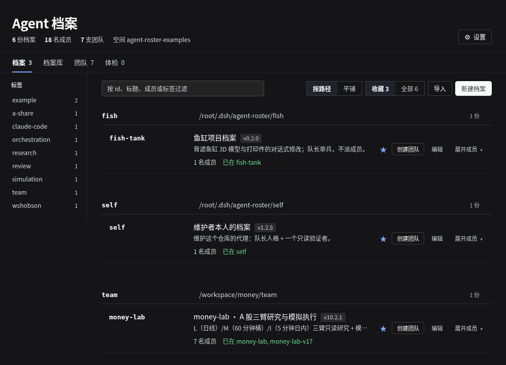
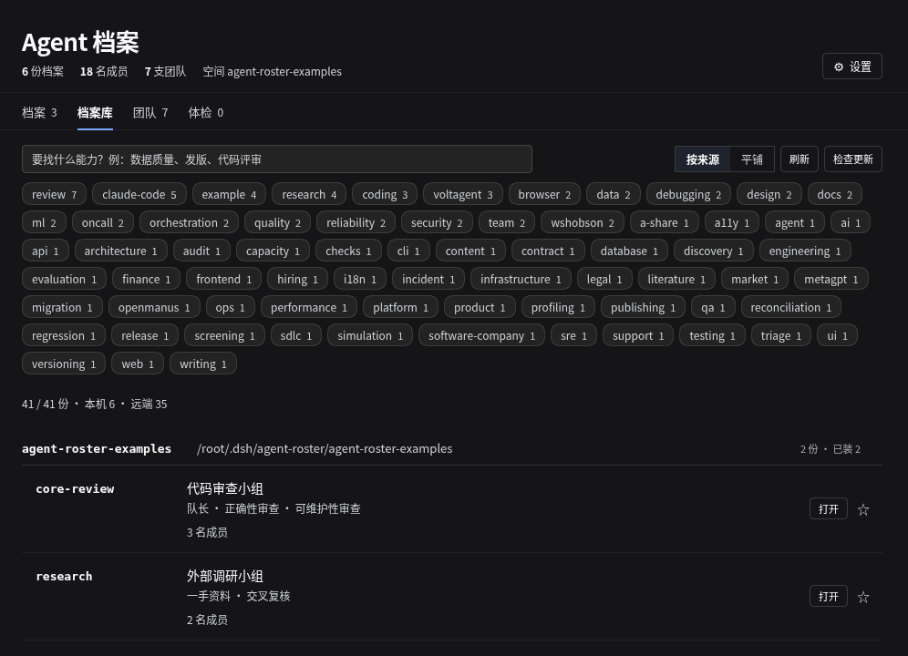

# @stofone/dsh-agent-roster

[English](README.en.md) | [**简体中文**](README.md)

**把团队写成一份建之前能评审、建完能核对的文件。**

面向 [DeepSeek Harness](https://github.com/deepseek-ai/deepseek-harness) Agent Teams 的**档案层**：人设、模型路由、工具边界写在 YAML/Markdown 里，编译成一份自包含产物；团队跑起来以后，再逐字段对着 `team.json` 核对运行时**真正存下的值**。它不运行团队，也不替代 [`dsh-agent-teams`](https://github.com/NanmiCoder/dsh-agent-teams)——它补的是引擎结构上不管的那一层。

<p align="center">
  <a href="https://www.npmjs.com/package/@stofone/dsh-agent-roster"></a>
  <a href="https://github.com/dsh-agent-roster/dsh-agent-roster/actions/workflows/registry.yml"></a>
  <a href="./LICENSE"></a>
</p>

<p align="center">
  
</p>

## 30 秒看懂

下面是对一支 14 人团队的真实 `roster_verify` 输出（节选，已去掉 agent-teams 不承载的字段）：

```text
[roster_verify] ok=false state=available members=14 deployed=14 faithful=7 unverified=0 drift=7 missing=0 unmanaged=1 toolFilter=14/14 policyDrift=0 provenance=0absent/1differ skills=0/0 requires=0missing/11 capabilityBlocked=0 captain=1

roster:money-lab@10.2.1  成员 14 · 已部署 14 · 一致 7

▸ report-builder  @ money-lab-v17   一致
   systemPrompt   运行时取值与档案一致  2494 字符
   model          运行时取值与档案一致  deepseek-v4.1-flash
   toolPolicy     运行时取值与档案一致  member-safe

▸ report-builder  @ money-lab       降级
   systemPrompt   运行时实际取值与档案不同  1741 字符  · 成员自带（运行时采用了不同的值）
```

这段输出里重要的三件事：

- **读的是运行时真正存下的值**，不是我们发出去的参数——所以能抓到「档案说 A、运行时是 B」。
- **拿不到证据就不冒充通过**：没有会话、读不到日志的项记「无法核对」，不记「一致」。
- **同一个人在两代团队里可以有不同结论**：`report-builder` 在新队 `money-lab-v17` 一致，在旧队 `money-lab` 被运行时覆盖——这正是换代前该看见的东西。

## 和 agent-teams 是什么关系

引擎负责**把团队跑起来**，我们负责**跑起来之前与之后能核对**。两者不重叠：

| | [`dsh-agent-teams`](https://github.com/NanmiCoder/dsh-agent-teams) | 本插件 |
|---|---|---|
| 团队从哪来 | 会话里一句自然语言，队长现场决定编制 | 写好的档案：人设、模型路由、工具边界、验收门 |
| 建完能不能核 | `team.json` 是运行时状态的唯一真源 | 逐字段比对档案与 `team.json`，报一致 / 降级 / 无法核对 |
| 人设能不能改 | 成员人设在 spawn 时冻结 | 队长人设每步重读，改文件下一步生效 |
| 换代带什么 | 不提供 | 队长摘要 + 每名成员的上下文包（含旧会话 id 与日志路径） |
| 该不该用它 | 要一支**能跑**的团队 | 要这支团队**可评审、可核对、可换代** |

可以只用引擎；一旦你想在事前评审编制、事后确认「跑的是不是我要的那套人」，就需要这一层。

## 安装

```bash
dsh plugin --profile web add @stofone/dsh-agent-roster
```

需要 Node.js ≥ 22.19 和一个跑着的 `dsh web`。装完重启一次 `dsh web`（插件在启动时加载）；之后左侧栏出现 **Agent 档案**，工具多出十三个 `roster_*`。

建团仍然需要 [`@nanmicoder/dsh-agent-teams`](https://github.com/NanmiCoder/dsh-agent-teams)：本插件把它声明为可选 peer，缺失时会直接告诉你安装命令。

兼容性：本插件在 DSH `0.2.2-rc.1` 上验证；引擎要求 `>= 0.1.27`。当前版本见 [Releases](https://github.com/dsh-agent-roster/dsh-agent-roster/releases/latest)，每个版本改了什么见 [CHANGELOG](./CHANGELOG.md)。

## 快速开始（不写 YAML）

1. **打开面板 → 档案库**。项目 registry 里发布过的档案按空间列出，可按能力搜索、按标签筛选。

   

2. **拉取一份档案**（Pull）。它被写进本机档案库，随后在「档案」页签里能看到成员与模型路由。

3. **创建团队**：在档案行上点「创建团队」——新会话（选工作区、会话名、队长模型）或落到已有会话。

4. **核对**：在那个会话里跑 `roster_verify`。逐字段给结论；被运行时覆盖的项显示为「降级」，档案值与运行时值并排给出。

想自己写？最小 v2 档案就是两个文件（`roles/<name>/AGENT.md` + `rosters/<id>/roster.yaml`），再 `compile` 一次。完整结构见 [docs/guide.md](./docs/guide.md#三种落盘形态)，[examples/](./examples) 是一座两份档案的示例库。

## 你会得到什么

| 能力 | 改变了什么 | 入口 |
|---|---|---|
| **会话人设可进化** | 队长的 system prompt 由同名 section 承载档案人设，**每个模型步重读**：你改、或会话自己改，下一步就生效——不用重启、不用重建。人设因此是一条能随运行继续生长的活文件，而不是 spawn 时冻死的一段文字。 | 自动 |
| 档案定义 | v2 三层：`roles/<name>/AGENT.md`（+ `parts/`、`{{> 引用}}`）→ `rosters/<id>/roster.yaml` → 自包含产物 `dist/` | `roster_compile` |
| 校验 | 字段归宿三分（direct / config / declaration）；门必须有可执行的 `verify`；能力要求只报 present / missing / unknown | `validate`、`roster_verify` |
| 建团 | 从档案生成建员参数；新开会话或落到指定会话，可选工作区与会话名 | `roster_team` |
| 换代 | 先比对档案与运行时 → 可选回写 → 新开会话或**在当前会话里换代**（已带队时先问是否归档）；队长用 `handover.summary`、成员用 `handover.members` 带过去 | `roster_iterate` |
| 核对 | 读 `team.json` 里**实际存下的** provider / model / reasoningEffort / toolPolicy，逐项报一致、降级、无法核对 | `roster_verify` |
| 回写 | 把运行时值写回档案；默认**先问再做** | `roster_capture` |
| 人设档案 | `members: []` + `captain.persona`：一个人设就是一个会话的身份，不建团队；应用到已有会话即刻生效 | 面板「应用」 |
| 知识层 | 角色与档案可声明 `knowledge:`，提示词只放「标题 + 概要 + 路径」，正文按需打开 | `roster_compile` |
| 面板 | 左侧栏「Agent 档案」：档案 / 档案库 / 团队 / 体检四页签，搜索、标签筛选、收藏、拉取空间、导入 | Web UI |
| 空间与订阅 | `space.yaml` 描述一座档案库；`clone` 拉取，`update` 报六态、冲突不自动合并 | `roster_space`、CLI |

## 最实用的用法：让上下文已经很重的会话，自己写档案并换代

一个跑了很久的项目会话，上下文里装着决策、踩过的坑、待办和每个成员的脾气。把整段对话搬给新会话，代价高、还会把过期结论一起搬过去；直接丢掉，又等于把项目记忆清零。

这里的做法是让**会话自己写一份档案**：队长人设、成员编制、模型与工具边界、验收门、交接指南，全部落到文件。之后用 `roster_iterate` 换出下一代——新会话从零开始，只带三样东西：上一代队长的交接摘要、每名成员的上下文包、可执行的分步清单。细节不整段搬运，只给指针：包里写着旧会话 id 与会话日志路径，需要时按路径回读原话。

档案是活文件，不是快照：改角色正文，队长下一步就按新人设说话（同名 section 每步重读），不用重建团队、不用重启。

三步：**写**（会话把「我们现在怎么做」落成档案）→ **换**（`roster_iterate` 写交接摘要与每名成员的包，投递指令写进起始消息）→ **核**（`roster_verify` 核对模型、工具边界、人设，以及每个包是否真的送到成员手里：已送达 / 未见送达 / 无法核对）。

边界说清楚：对话记录不迁移，只留指针；成员人设是 spawn 时冻结的，换成员就要换代；队长人设是唯一随时改随时生效的部分。

## 它是什么 / 不是什么

| 是 | 不是 |
|---|---|
| 定义与校验层：格式可版本化、可评审，写错时带文件路径与字段路径报错，不静默降级 | 团队运行时：不建成员、不调度任务、不替代调度器 |
| 对 `dsh-agent-teams` 的桥接：产出可直接使用的建员参数，并逐字段标注运行时是否真的接收 | 不写 `.agent-teams/` 状态：只读，用于核对 |
| 核对手段：只认 `team.json` 里实际存下的值 | 不假装通过：证据源缺席时记「无法核对」 |

## 文档

| 文档 | 讲什么 |
|---|---|
| [docs/guide.md](./docs/guide.md) | **完整手册**：三种落盘形态、v1/v2 格式、正文引用、公共知识、字段归宿、能力要求、空间、面板、十三个工具、命令行、路由、配置、诊断 |
| [docs/roster-v2.md](./docs/roster-v2.md) | v2 格式规范（角色 / 档案 / 产物 / 施工图） |
| [docs/design.md](./docs/design.md) | 设计取舍与模块落点 |
| [CHANGELOG.md](./CHANGELOG.md) | 每个版本改了什么、为什么、影响面 |
| [examples/](./examples)、[examples-orchestration/](./examples-orchestration) | 两座示例库：最小档案；带门与施工图的编排 |

## 边界

- 不跑团队、不调度、不写 `.agent-teams/`；也**不自动重启**任何服务。
- 一个会话最多领导一支团队；同一档案的换代请走 `roster_iterate`，而不是原地重建。
- 面板改档案 = 改文件；`.agent-teams/` 里的运行时值不会被面板改写。

## 开发与验证

```bash
node --test              # 498 个测试
npm run smoke            # 宿主 + 客户端两段冒烟
npm run check:host       # 四条宿主契约（对着装好的 DSH 读）
npm run check:locale     # 面板文案 en/zh 对齐
node bin/cli.mjs validate --dir examples
npm run e2e              # 真起宿主：面板 17 项
```

## 维护与发版节奏

本仓库由 AI 维护，节奏是公开的，方便你判断「我的问题什么时候会有版本」：

- **每天两次处理**（北京时间 12:00 / 18:00）：12:00 只处理 issue 与 PR，不动版本号；**18:00 才是发版窗口**。
- **一天最多一个版本**；当天没有实质改动就不发。
- **合并 ≠ 已发布**：改动先合入 `main`，随下一个版本发布；`CHANGELOG.md` 的 `Unreleased` 段会写明「计划随哪个版本发布」。
- 版本按 SemVer 定级：修 bug 走 patch，新增能力走 minor；一批里含新能力就整批发 minor。
- GitHub 的 Release 只为 minor（`x.y.0`）建：patch 的改动仍在 `CHANGELOG.md` 和对应标签里。
- 所有改动（包括维护者自己的）都走 pull request，`verify` 通过才合并。

## 许可

MIT。示例库与角色素材的许可见各自目录；`@michengai/dsh-agency-agents` 导入的素材遵循其 Apache-2.0 NOTICE。
